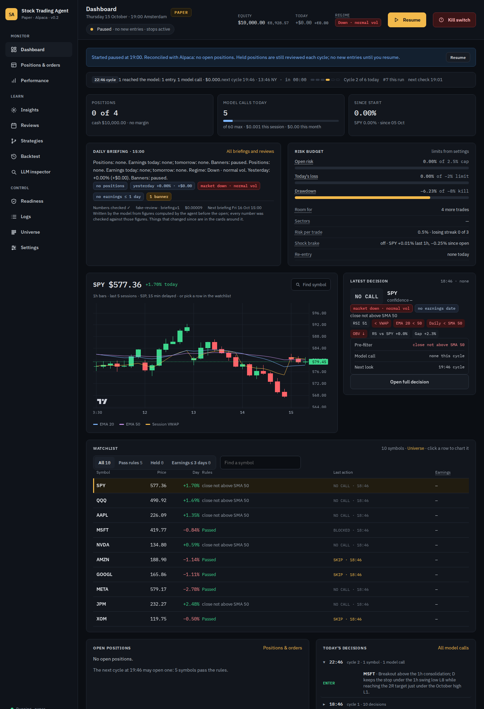
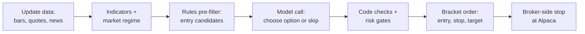
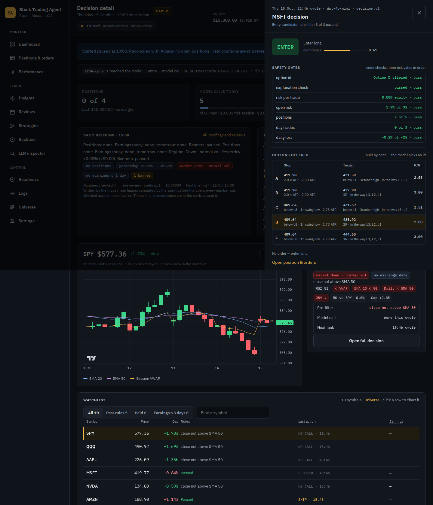
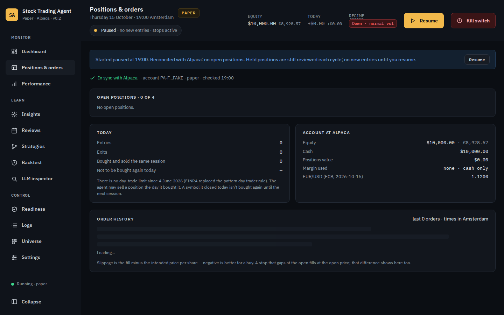
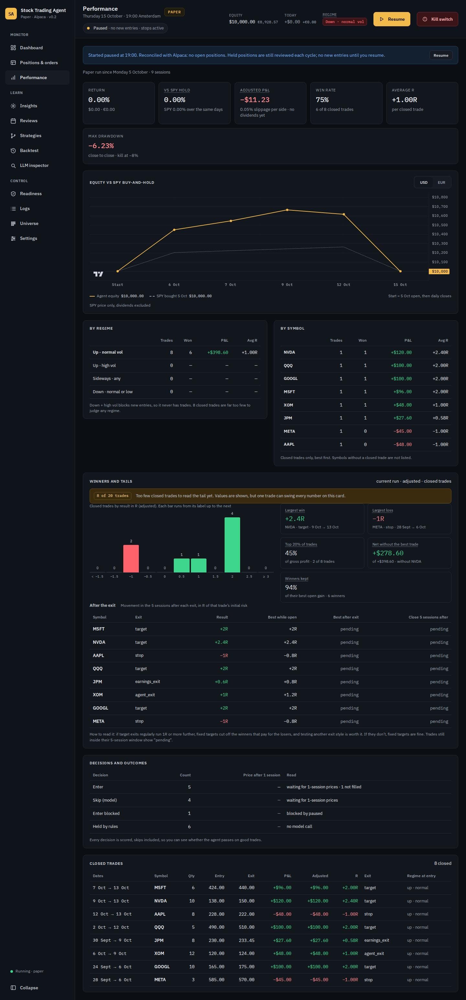
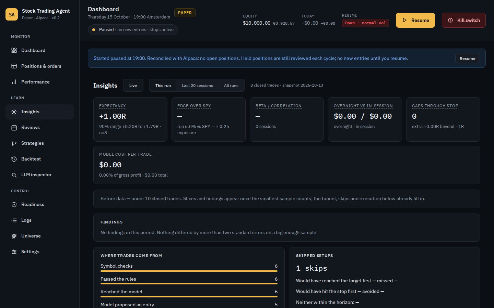
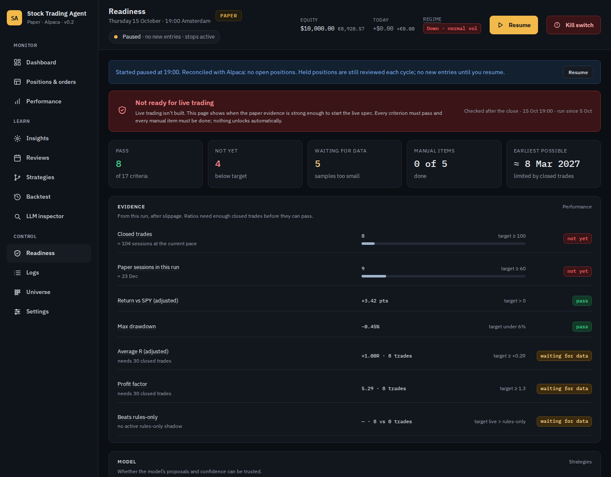
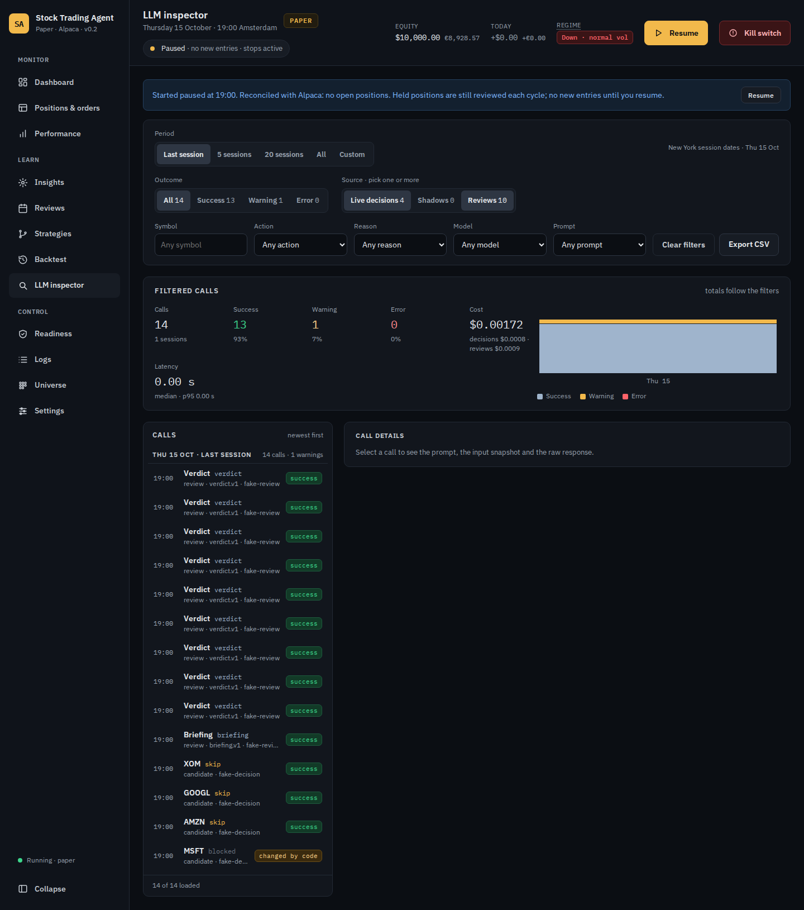
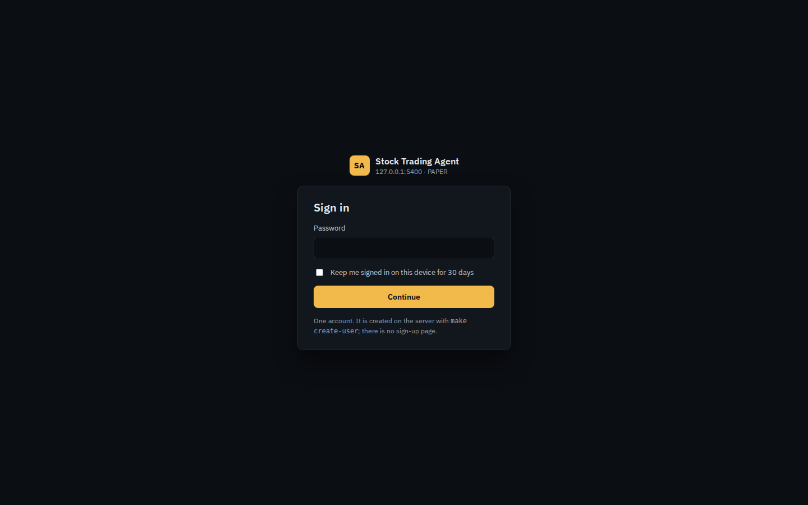
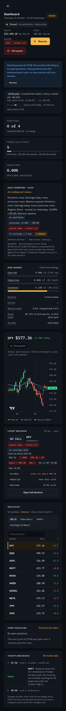

# Stock Trading Agent

A paper-trading agent for liquid US stocks and ETFs on Alpaca. An OpenAI
model picks from options built by code; every order passes deterministic
rules and risk gates before it can go out.

> **Paper only.** The agent only ever places orders on an Alpaca paper
> account — no code path can place a real-money order. It is a personal
> experiment and not financial advice.

[](https://github.com/mnolte/stock-trading-agent/actions/workflows/ci.yml)



## Contents

- [What it does](#what-it-does)
- [Safety model](#safety-model)
- [Screenshots](#screenshots)
- [Requirements](#requirements)
- [Installation](#installation)
- [Configuration](#configuration)
- [Usage basics](#usage-basics)
- [Commands](#commands)
- [Project layout](#project-layout)
- [Contributing](#contributing)
- [Roadmap and status](#roadmap-and-status)
- [License](#license)
- [Disclaimer](#disclaimer)

## What it does

- **Universe.** Trades a fixed list of liquid US symbols (default: SPY,
  QQQ, AAPL, MSFT, NVDA, AMZN, GOOGL, META, JPM, XOM). A screened mode
  runs a daily liquidity screen over a larger pool (up to 150 symbols)
  and cycles over the eligible plus held symbols.
- **Decision cycles.** Six cycles per US session at 10:46, 11:46, 12:46,
  13:46, 14:46 and 15:46 New York time — 16:46 to 21:46 Amsterdam most
  of the year — each running on a freshly closed session-aligned 1-hour
  bar. Between cycles a 15-minute position check reconciles the broker,
  re-verifies every stop, and updates the session brakes.
- **How a decision is made.** A deterministic rules pre-filter picks
  entry candidates; the model then chooses an action — under
  `decision.v2`, one of the stop/target options code already built to
  satisfy the geometry rules, or skip. Held positions are reviewed for
  hold, tighten-stop or exit. Invalid model output becomes skip (hold
  for a position); the model can never override a rule or a gate.
- **Risk gates in code.** Risk per trade, max position size, total open
  risk, position and sector caps, cash-only sizing, daily loss limit,
  losing streak, shock brake, earnings blackout and exit, same-session
  re-entry block, drawdown kill and order sanity checks — all run in
  code after the model answers.
- **Orders.** Every entry is a bracket order at Alpaca: limit entry,
  stop-loss leg, take-profit leg (`gtc`). A fresh quote and a re-run of
  sizing and gates happen at order time. Exits cancel the open legs
  before a market sell, so a position can never be sold twice.
- **Tracking.** Every decision — including skips — is stored with its
  inputs, prompt version, model output, gate results and the price
  outcome after 1 hour, 1 session and 5 sessions. Performance is
  measured against SPY buy-and-hold started on the same day.
- **Strategies and shadows.** Shadow strategies decide on the same inputs
  each cycle with virtual portfolios — comparing another prompt, model
  or rules-only trading with live evidence, without touching the broker.
- **Backtests and replays.** The live cycle code replays strategies over
  past sessions with the fake broker, and `make replay` re-runs a prompt
  version over stored snapshots.
- **Reviews and insights.** The model writes a weekly review, a daily
  briefing and draft verdicts on decisions — always from facts computed
  by code. Insights slices the run's results by time, sector, regime,
  confidence and more; Readiness tracks whether the paper evidence would
  ever justify live trading (nothing unlocks automatically).

One cycle, end to end:



## Safety model

- **Paper only.** The Alpaca client is always created with `paper=True`;
  a test fails the build if the live base URL appears anywhere. At
  startup the account is verified to be a paper account or the app
  refuses to start. The PAPER badge shows on every screen.
- **Every position has a broker-side stop.** Entries are bracket orders
  with `gtc` legs, so positions stay protected between cycles and when
  the app is down. A position found without a stop gets a protective
  order immediately, then a critical alert.
- **The model never overrides code.** Rules, gates and order mechanics
  run in code. A used prompt file is never edited — a change is a new
  version.
- **No shorting, 1× margin.** `no_shorting` and `max_margin_multiplier`
  are set and verified on the paper account at startup (`make
  broker-guard`); every sell is capped at the confirmed position
  quantity.
- **Kill switch.** Manual (header) or automatic (drawdown, repeated
  failures) — stops all new entries, leaves stops in place. "Stop &
  flatten" also cancels all orders and sells every position at market.
  A kill switch that was on stays on across restarts; resuming needs a
  typed reason.
- **Sign-in when not on 127.0.0.1.** Locally the app binds to
  `127.0.0.1` with `SA_AUTH=off`. On any other address `SA_AUTH=required`
  is mandatory — password plus authenticator code — and the app refuses
  to start otherwise.
- **Paused at startup.** The agent always comes up with new entries
  paused; cycles, position checks and existing stops run normally until
  Resume is pressed.

## Screenshots

All images were captured from the running app in `MODE=simulated` with
seeded fixture data (`make readme-screens`) — no real account, key or
position appears.

| Screen | What it is for |
| --- | --- |
|  | Today's session at a glance: cycle counter, risk budget, briefing, price chart, watchlist, decisions feed. |
|  | One decision: gates, code-built options (decision.v2), levels, reasoning, outcome. |
|  | Open positions and their bracket legs, reconciliation status, account, order history. |
|  | Equity vs SPY, raw vs adjusted P&L, winners and tails, closed trades. |
|  | Where the results come from: funnel, findings, slices, calibration. |
|  | Whether the paper evidence would justify live trading — 17 criteria and manual items. |
|  | Every model call since the start with outcome, cost, prompt and raw response. |
|  | API keys, trading, risk, rules, notifications, schedule, access, server. |
|  | Password plus authenticator code; one account, no sign-up. |
|  | The same dashboard at phone width — the VPS instance can be checked from a phone. |

## Requirements

- **Python 3.12** — pinned by `pyproject.toml` (`requires-python =
  ">=3.12"`) and the CI image (`python:3.12-slim`).
- **Node 20 and pnpm 12.11.2** — Node version used in CI
  (`actions/setup-node`, `node-version: "20"`); pnpm pinned by
  `frontend/package.json` (`packageManager: pnpm@12.11.2`). The
  production image builds the frontend on Node 22.
- **uv** (optional, recommended) — `make install` uses `uv sync` with
  `uv.lock` when available, else a plain venv + pip.
- An **Alpaca paper account** with API keys — a paper-only account works
  from the Netherlands.
- An **OpenAI API key** — the decision and review model is
  `gpt-4o-mini` by default.
- A **Finnhub API key** (free plan) — the earnings calendar.
- **Docker and Docker Compose** — only for the VPS (production).

## Installation

### Local

```bash
git clone https://github.com/mnolte/stock-trading-agent.git
cd stock-trading-agent
cp .env.example .env                        # mode, host, port, paths — no keys
cp backend/config.example.yaml backend/config.yaml
make install                                # backend deps + frontend deps
make run                                    # builds the GUI, serves on 127.0.0.1:SA_PORT
```

The app starts **paused**: it reconciles with Alpaca and watches
positions, but places no new entries.

1. Open the GUI and enter the keys in **Settings → API keys** (Alpaca
   paper key ID and secret, OpenAI, Finnhub). Each key is tested before
   it is saved.
2. Check the header shows the **PAPER** badge.
3. Reset the paper account to **$10,000** in the Alpaca dashboard before
   the first run (`performance.starting_equity` is checked against it).
4. Press **Resume**. The first cycle runs at 10:46 New York (16:46
   Amsterdam most of the year).

### Simulated mode without keys

```bash
MODE=simulated make run    # or make dev — recorded bars + fake broker, no network
```

### Development

```bash
make dev                   # backend with reload + Vite dev server; Ctrl-C stops both
```

### Production on a VPS

Production runs as Docker Compose — an `app` container that is never
public and a Caddy container that terminates HTTPS — behind sign-in with
a password and an authenticator app. Provisioning, deploying, backups,
restoring and moving a local database are in
[docs/DEPLOY.md](docs/DEPLOY.md).

## Configuration

Three places, in order of where things live:

| Where | What |
| --- | --- |
| `.env` | Mode, bind address, paths, sign-in mode, deploy stamps — never keys. |
| `backend/config.yaml` | Every behavioural default from the spec. |
| Settings → API keys | The four keys and the SMTP password, stored encrypted. |

### Environment variables

Every variable the app or the deploy files read:

| Variable | Default | Values | What it does | When to change |
| --- | --- | --- | --- | --- |
| `MODE` | `paper` | `paper`, `simulated` | Paper broker + live data fakes (`simulated` needs no keys and no network) | Demos, e2e, running without keys |
| `SA_HOST` | `127.0.0.1` | bind address | Interface the app listens on; `0.0.0.0` inside the VPS container | Only on the VPS |
| `SA_PORT` | `8000` | port | Port the app binds | When the port collides |
| `SA_DATA_DIR` | `./data` | path | Database, `secret.key`, logs, backups, backtests | Custom data location |
| `SA_DB_PATH` | `./data/stock-agent.db` | path | The trading database file | Custom database location |
| `SA_AUTH` | `off` | `off`, `required` | Sign-in gate; `off` on anything but 127.0.0.1 refuses to start | `required` on the VPS (Compose sets it) |
| `SA_PUBLIC_URL` | `http://127.0.0.1:8000` | URL | Public base URL Caddy serves; used for cookie/origin checks | On the VPS (`https://<domain>`) |
| `SA_TRUSTED_PROXY` | (empty) | addresses | Whose `X-Forwarded-For` to trust; Compose sets Caddy's address | On the VPS |
| `SA_INSTANCE_ID` | `sa-local` | id | Stamped into every client order id; two copies on one account trip the kill switch | One per copy (`sa-vps-1` on the VPS) |
| `SA_SIM_NOW` | (empty) | ISO 8601 | Frozen clock for simulated mode | Tests and demos only |
| `SA_RELOAD` | (unset) | `1` | Uvicorn auto-reload for `python -m app.serve` | Set by `make dev` |
| `SA_ENV_FILE` | repo `.env` | path | `.env` path the one-time key import reads | Tests (point at an empty file) |
| `SA_DOMAIN` | `stock.example.nl` | DNS name | The name Caddy serves; must be the host part of `SA_PUBLIC_URL` | On the VPS |
| `SA_VERSION` | `dev` | image tag | The image tag `deploy.sh` last installed; shown in Settings → Server | Written by `deploy.sh` |
| `SA_DEPLOYED_AT` | (empty) | timestamp | Deploy stamp shown in Settings → Server | Written by `deploy.sh` |
| `HTTP_PORT` | `80` | port | Caddy's public HTTP port in Compose | Port clashes on the VPS |
| `HTTPS_PORT` | `443` | port | Caddy's public HTTPS port in Compose | Port clashes on the VPS |
| `SA_DOCKER` | `docker` | binary | Docker binary the deploy scripts call | Non-standard Docker install |
| `SA_NO_ACT` | (unset) | `1` | `deploy.sh`/`restore.sh` print commands instead of running | Dry-run a deploy |
| `SA_DEPLOY_NOW` | now | UTC timestamp | Overrides "now" for `deploy.sh`'s market-hours guard | Testing the guard |
| `SA_DEPLOY_GUARD` | `1` | `0`/`1` | Set `0` to skip `deploy.sh`'s market-hours guard | Emergency deploys |
| `SA_OFFSITE_RESTORE` | (unset) | `1` | Marks the restore one-off container (restore.sh) | Internal to restore.sh |
| `VITE_API_PORT` | `SA_PORT` | port | The backend port the Vite dev server proxies to | Set by `make dev` |
| `TZ` | `Europe/Amsterdam` (image) | timezone | Log rotation and daily jobs follow Amsterdam time | Set in the image |

Keys do **not** belong in `.env`. `ALPACA_API_KEY`, `ALPACA_SECRET_KEY`,
`OPENAI_API_KEY` and `FINNHUB_API_KEY` found there are imported once at
startup, tested, stored encrypted, then ignored — remove them after the
import banner appears.

### `backend/config.yaml`

Every key in `config.example.yaml`, grouped by top-level block. "Settings"
means changeable in the Settings screen (saved as a new version, applies
next cycle); "file" means edit the YAML.

<details><summary><code>universe</code> — symbols, pool, daily screen</summary>

| Key | Default | Unit | What it does | Where |
| --- | --- | --- | --- | --- |
| `universe.symbols` | SPY, QQQ, AAPL, MSFT, NVDA, AMZN, GOOGL, META, JPM, XOM | list | The fixed universe | Settings |
| `universe.sectors` | per-symbol map | GICS + Index | Sector for the sector cap; required when adding a symbol | Settings |
| `universe.mode` | `fixed` | `fixed`/`screened` | Fixed list vs daily liquidity screen (spec → Larger universe) | Settings |
| `universe.pool_file` | `backend/universe/pool.csv` | path | Default pool (72 symbols) loaded once | file |
| `universe.max_pool` | `150` | symbols | Pool size cap | file |
| `universe.screen.time_ny` | `08:10` | NY time | Daily screen time, after the daily bars refresh | file |
| `universe.screen.min_price` | `10` | USD | Last close floor | Settings |
| `universe.screen.min_avg_dollar_volume` | `100000000` | USD | 20-session average dollar volume floor | Settings |
| `universe.screen.lookback_sessions` | `20` | sessions | Dollar-volume and rank window | Settings |
| `universe.screen.drop_after_failed_screens` | `3` | screens | Eligible symbols drop after this many failed screens | file |
| `universe.rank_by` | `return_vs_spy` | metric | Eligible rank: 20-session return minus SPY's | file |
| `universe.watchlist_rows` | `15` | rows | Dashboard rows in screened mode before "Show all" | file |
| `universe.allowed_sectors` | 11 GICS + Index | list | Sectors Settings offers when adding a symbol | file |

</details>

<details><summary><code>app</code> — display timezone</summary>

| Key | Default | Unit | What it does | Where |
| --- | --- | --- | --- | --- |
| `app.timezone` | `Europe/Amsterdam` | tz | GUI, logs, alerts, daily jobs; timestamps stored UTC | file |

</details>

<details><summary><code>schedule</code> — cycles, checks, history (spec → Market, schedule and data)</summary>

| Key | Default | Unit | What it does | Where |
| --- | --- | --- | --- | --- |
| `schedule.market_timezone` | `America/New_York` | tz | Cycles follow the exchange clock | file |
| `schedule.cycles` | `10:46`–`15:46` hourly | NY times | Six decision cycles per session | Settings (read-only) |
| `schedule.last_cycle_no_entries` | `true` | bool | No new entries in the last cycle | file |
| `schedule.position_checks` | 15-minute grid | NY times | Position checks between cycles | Settings (read-only) |
| `schedule.position_check_failures_alert` | `3` | failures | Consecutive check failures before an alert | file |
| `schedule.calendar_refresh` | `08:00` | NY time | Trading calendar + daily bars refresh | file |
| `schedule.misfire_grace_seconds` | `120` | s | Missed cycles are never run late | file |
| `schedule.history_sessions` | `60` | sessions | 5-min bar history per symbol | file |
| `schedule.daily_history_sessions` | `260` | sessions | Daily bars (SMA 200 + ATR percentile) | file |
| `schedule.bar_adjustment` | `split` | enum | Split-adjusted bar requests | file |
| `schedule.bars_5m_keep_sessions` | `120` | sessions | 5-min bar pruning | file |
| `schedule.cycle_duration_warn_minutes` | `10` | min | Cycle longer than this warns | file |

</details>

<details><summary><code>execution</code> — orders, quotes, spreads (spec → Alpaca integration)</summary>

| Key | Default | Unit | What it does | Where |
| --- | --- | --- | --- | --- |
| `execution.mode` | `automatic` | `automatic`/`supervised` | Entries auto or via approval | Settings |
| `execution.entry_limit_offset_pct` | `0.05` | % | Entry limit above market price | file |
| `execution.entry_timeout_minutes` | `10` | min | Unfilled entry cancel | file |
| `execution.max_spread_pct` | `0.15` | % | Spread check when the quote is plausible | file |
| `execution.quote_max_deviation_pct` | `1.0` | % | Last trade vs bar (`price_suspect`) and plausible-quote band | file |
| `execution.quote_max_age_seconds` | `60` | s | IEX last-trade freshness (`price_stale`) | file |
| `execution.time_in_force` | `gtc` | tif | Bracket legs survive overnight | file |

</details>

<details><summary><code>rules</code> and <code>regime</code> — pre-filter and market regime (spec → Decision layer)</summary>

| Key | Default | Unit | What it does | Where |
| --- | --- | --- | --- | --- |
| `rules.rsi_min` / `rules.rsi_max` | `40` / `70` | RSI | Candidate RSI band | Settings |
| `rules.require_daily_above_sma50` | `true` | bool | Daily close above SMA 50 | Settings |
| `rules.require_ema20_above_ema50` | `true` | bool | 1h EMA 20 above EMA 50 | Settings |
| `regime.vol_low_below_pct` | `30` | percentile | Low-volatility boundary (SPY ATR percentile) | file |
| `regime.vol_high_above_pct` | `70` | percentile | High-volatility boundary | file |
| `regime.block_entries_in` | `down_high` | regimes | Regimes that block all entries | file |

</details>

<details><summary><code>decision</code> — model, checks, option builder, replay (spec → Decision layer, Decision v2)</summary>

| Key | Default | Unit | What it does | Where |
| --- | --- | --- | --- | --- |
| `decision.model` | `gpt-4o-mini` | model | Decision model | Settings |
| `decision.temperature` | `0` | temp | Deterministic output | Settings |
| `decision.prompt` | `decision.v1` | prompt | Prompt version (immutable once used) | Settings |
| `decision.min_confidence_enter` | `0.55` | 0–1 | Minimum confidence for enter | Settings |
| `decision.stop_atr_min` / `decision.stop_atr_max` | `1.5` / `4.0` | × ATR(1h) | Allowed stop distance | Settings |
| `decision.min_reward_risk` | `1.5` | ratio | Minimum reward to risk | Settings |
| `decision.tighten_min_atr_below_price` | `0.25` | × ATR | New stop must sit this far below the reference | Settings |
| `decision.max_calls_per_cycle` | `10` | calls | Model-call cap; held positions first | Settings |
| `decision.call_timeout_seconds` | `30` | s | Call timeout, never retried | file |
| `decision.options.*` | see file | builder | v2 option builder: swing strength/lookbacks, level buffer, ATR and R multiples, dedupe, max stops/options, held trail | file |
| `decision.replay.confirm_above_usd` | `2.0` | USD | `make replay` asks above this estimate | file |

</details>

<details><summary><code>risk</code> — all risk gates (spec → Risk management)</summary>

| Key | Default | Unit | What it does | Where |
| --- | --- | --- | --- | --- |
| `risk.risk_per_trade_pct` | `0.5` | % of equity | Shares = risk budget ÷ (entry − stop) | Settings |
| `risk.max_position_pct` | `20` | % of equity | Max size per position | Settings |
| `risk.max_open_risk_pct` | `2.5` | % of equity | Total open risk across positions and working entries | Settings |
| `risk.max_open_positions` | `4` | positions | Position cap | Settings |
| `risk.max_per_sector` | `2` | positions | Per-sector cap | Settings |
| `risk.cash_only` | `true` | bool | Order value ≤ cash; margin never used | locked |
| `risk.daily_loss_limit_pct` | `2.0` | % of equity | No new entries for the rest of the session | Settings |
| `risk.losing_streak` | `3` | losses | Streak that halves risk per trade | Settings |
| `risk.losing_streak_risk_factor` | `0.5` | factor | The halving | Settings |
| `risk.shock_brake_1h_pct` / `risk.shock_brake_session_pct` | `1.5` / `2.5` | % | SPY moves that block entries this session | Settings |
| `risk.earnings_blackout_days` | `3` | trading days | No entry within earnings | Settings |
| `risk.hold_through_earnings` | `false` | bool | Earnings exit the day before | Settings |
| `risk.reentry_same_session` | `false` | bool | No re-entry in a symbol closed earlier this session | Settings |
| `risk.drawdown_kill_pct` | `8` | % | Equity vs peak that turns the kill switch on | Settings |
| `risk.adopted_stop_atr` | `3` | × ATR | Protective stop for a position found at Alpaca | file |
| `risk.protective_stop_fallback_pct` | `3` | % | Fallback when ATR unavailable | file |
| `risk.max_order_pct` | `25` | % of equity | Single-order sanity cap | file |
| `risk.max_orders_per_cycle` | `6` | orders | Order count sanity cap | file |
| `risk.failed_cycles_kill` | `3` | failures | Failed cycles that turn the kill switch on | file |

</details>

<details><summary><code>performance</code> — run bookkeeping and tail metrics (spec → Alpaca integration, Tail metrics)</summary>

| Key | Default | Unit | What it does | Where |
| --- | --- | --- | --- | --- |
| `performance.starting_equity` | `10000` | USD | Checked by "Start new run" after a paper reset (±1%) | Settings |
| `performance.slippage_pct_per_side` | `0.05` | % | Adjusted-P&L slippage assumption | Settings |
| `performance.benchmark` | `SPY` | symbol | Buy-and-hold benchmark | file |
| `performance.tail.*` | see file | metrics | Winners-and-tails card: R bucket, top share, after-exit window, min trades | file |

</details>

<details><summary><code>reviews</code> — weekly review, briefing, verdicts (spec → Reviews)</summary>

| Key | Default | Unit | What it does | Where |
| --- | --- | --- | --- | --- |
| `reviews.weekly_day` / `reviews.weekly_time` | `saturday` / `10:00` | day, Amsterdam time | Weekly review schedule | Settings |
| `reviews.briefing_enabled` / `reviews.briefing_time_ny` | `true` / `09:00` | bool, NY time | Daily briefing on trading days | Settings |
| `reviews.verdict_after_sessions` | `5` | sessions | Verdict written once the 5-session outcome is in | file |
| `reviews.model` / `reviews.temperature` | `gpt-4o-mini` / `0.2` | model | Review writer | Settings |
| `reviews.prompts` | `weekly.v1`, `briefing.v1`, `verdict.v1` | prompts | Versioned, never edited once used | file |
| `reviews.max_words` | `120` / `80` | words | Weekly summary / briefing length | file |
| `reviews.monthly_cost_cap_usd` | `2` | USD | Review-call cap, separate from decisions | Settings |

</details>

<details><summary><code>notifications</code> — channels, quiet hours, SMTP (spec → Notifications)</summary>

| Key | Default | Unit | What it does | Where |
| --- | --- | --- | --- | --- |
| `notifications.repeat_limit_minutes` | `30` | min | Same-subject limit; critical events never held | Settings |
| `notifications.quiet_hours` | `23:00`–`08:00` | Amsterdam | Only critical events inside quiet hours | Settings |
| `notifications.email.*` | `smtp_port 587`, `starttls` | SMTP | Host, port, username, from/to; password is a Settings secret | Settings |
| `notifications.events.*` | per event | channels | browser/email per event; critical always includes browser | Settings |

</details>

<details><summary><code>model_prices</code> — USD per million tokens, the only price source</summary>

| Key | Default | Unit | What it does | Where |
| --- | --- | --- | --- | --- |
| `model_prices.gpt-4o-mini` | `{input: 0.15, output: 0.60}` | USD/Mtok | Cost computed per call and stored with it | file |
| `model_prices.gpt-4.1-mini` | `{input: 0.40, output: 1.60}` | USD/Mtok | Same; unpriced models are refused | file |

</details>

<details><summary><code>shadows</code> and <code>backtest</code> — shadow strategies and backtesting (spec → Strategies and shadows, Backtesting)</summary>

| Key | Default | Unit | What it does | Where |
| --- | --- | --- | --- | --- |
| `shadows.max_active` | `3` | strategies | Active + paused shadow slots | file |
| `shadows.monthly_cost_cap_usd` | `5` | USD | Shadow model-call cap | file |
| `shadows.promote_min_closed_trades` | `20` | trades | Closed trades before "Promote to live" | file |
| `shadows.rules_only` | `{stop_atr: 2.0, target_r: 2.0}` | geometry | Rules-only baseline stop/target | file |
| `backtest.monthly_cost_cap_usd` | `20` | USD | Backtest model-call cap | file |
| `backtest.max_range_years` | `3` | years | Longest backtest period | file |
| `backtest.alpaca_calls_per_minute` | `40` | calls | Backtest download limit (live keeps 150) | file |
| `backtest.assumed_spread_pct` | `0.05` | % | Assumed spread (no historical quotes on free data) | file |
| `backtest.same_bar_stop_and_target` | `stop` | rule | Both legs touched in one bar | file |
| `backtest.data_dir` / `backtest.bar_store` | `data/backtests`, `data/backtests/bars.db` | paths | Run folders and the never-pruned bar store | file |
| `backtest.cancel_grace_seconds` / `backtest.process_nice` | `60` / `10` | s / nice | Cancel grace, child priority | file |
| `backtest.model_cutoffs` | per model | dates | LLM strategies only from the day after the model's cutoff | file |

</details>

<details><summary><code>readiness</code>, <code>insights</code>, <code>inspector</code> — evidence, slices, call history</summary>

| Key | Default | Unit | What it does | Where |
| --- | --- | --- | --- | --- |
| `readiness.*` | see file | thresholds | The 15-criterion defaults (≥100 closed trades, ≥60 sessions, >0 vs SPY, <6% drawdown, ≥+0.2R, ≥1.3 profit factor, ≥75% proposal pass, ≤10 pt calibration gap, ≥98% cycles, ≤5% price-blocked, 60 min auto-resolve, log windows) | Settings |
| `insights.*` | see file | thresholds | Finding minimums (30/10 trades, 2σ), 90% range z, `insights.skip_score` geometry, gap/flat buckets | file |
| `inspector.page_size` | `50` | calls | Inspector page (API allows 100) | file |
| `inspector.slow_call_seconds` | `15` | s | Returned call slower than this warns "slow" | file |
| `inspector.default_sources` | `live`, `review` | sources | Shadows off by default | file |

</details>

<details><summary><code>logging</code>, <code>security</code>, <code>auth</code>, <code>ops</code>, <code>storage</code> — operations</summary>

| Key | Default | Unit | What it does | Where |
| --- | --- | --- | --- | --- |
| `logging.dir` / `logging.index` | `data/logs`, `data/logs/logs.db` | paths | Log files and the separate index | file |
| `logging.file_level` / `logging.console_level` | `DEBUG` / `INFO` | levels | Everything to file; info to console | file |
| `logging.max_file_mb` / `logging.max_files` / `logging.keep_days` | `50` / `20` / `30` | MB, files, days | Rotation and pruning (files + index) | file |
| `logging.page_size` | `100` | lines | Logs screen page (API allows 200) | file |
| `logging.client_errors_per_minute` | `10` | errors | Frontend error report limit | file |
| `logging.heartbeat_seconds` | `30` | s | `run.lock` heartbeat for unclean-stop detection | file |
| `logging.backtest_kill_after_seconds` | `10` | s | Shutdown: after the cancel flag | file |
| `security.allowed_hosts` | `[]` | names | Extra `Host` names the request gate accepts | file |
| `security.max_body_kb` / `security.max_upload_kb` | `1024` / `5120` | KB | JSON body cap / CSV import cap | file |
| `security.export_max_rows` | `100000` | rows | Log, LLM-call and CSV export cap | file |
| `security.client_error_senders` | `1000` | addresses | Frontend-error rate-limit table size | file |
| `auth.*` | see file | PR 23 | Sign-in: 12 h idle, 30-day max, ≥14-char password, lockouts, "Confirm it is you" validity, recovery codes | Settings → Access |
| `ops.resume_after_clean_restart` | `auto` | enum | On the VPS the agent resumes itself after a clean planned restart | file |
| `ops.heartbeat_url` | (empty) | https URL | Dead-man's-switch ping after each cycle and check | Settings → Server |
| `ops.disk_warn_pct` / `ops.disk_critical_pct` | `80` / `90` | % | Disk alerts | file |
| `ops.clock_max_offset_seconds` | `1` | s | Clock drift warning | file |
| `ops.cert_warn_days` | `14` | days | Certificate-expiry warning | file |
| `ops.offsite_backup` | `enabled: false` | backup | Encrypted offsite copy after the 03:00 local backup | Settings → Server |
| `ops.deploy_guard_market_hours` | `true` | bool | `deploy.sh` refuses during the session | file |
| `storage.backup_time` | `03:00` | Amsterdam | Daily database copy via SQLite online backup + integrity check | file |
| `storage.backup_days` | `14` | days | Local backup retention | file |
| `storage.shutdown_grace_seconds` | `60` | s | Wait for a running cycle/check on Ctrl+C | file |
| `storage.sqlite_busy_timeout_seconds` | `30` | s | WAL busy timeout; no write lock across a network call | file |

</details>

### Settings and API keys

Keys are entered in **Settings → API keys**, never in `.env`. They are
encrypted with Fernet and stored in the `secrets` table; the encryption
key is `data/secret.key` (mode 600, created at first start, never in the
database — back that file up separately). The API is write-only for
keys: reads return only the name, last 4 characters and test result.
Every new key is tested before saving (Alpaca `GET account` on the paper
endpoint, OpenAI list models, Finnhub one calendar request).

Settings changed in the GUI are stored as rows in `settings_versions`
and apply at the next cycle, each with a required reason.

## Usage basics

A trading day, in Amsterdam time (the GUI's timezone):

| Amsterdam | What happens |
| --- | --- |
| 14:00 | Trading calendar + daily bars refresh; daily liquidity screen at 14:10 (screened mode). |
| 15:00 | Daily briefing written (09:00 New York). |
| 15:30 | Market opens (09:30 New York); position checks start. |
| 16:46–21:46 | Six decision cycles, hourly. |
| ~22:00 | Close; session-close jobs: outcome fills, readiness and insights snapshots, after-exit metrics. |
| 03:00 | Daily database backup to `data/backups/` (14 days). |

**Clock-change weeks.** Europe and the US change clocks on different
dates (in 2026, EU on 25 October, US on 1 November). For that week the
offset is 5 hours instead of 6, so cycles land an hour earlier in
Amsterdam. Times are always correct in the GUI — every time shows
Amsterdam with New York on hover — because scheduling runs on
`America/New_York`, never a hard-coded offset.

Where to look:

- **Dashboard** — today's session, cycles, watchlist, decisions.
- **Positions & orders** — open positions, bracket legs, order history.
- **LLM inspector** — every model call, filterable by period, outcome,
  source; decisions feed links here.
- **Logs** — every log line, warnings and up by default, recurring
  problems.
- **Readiness** — the evidence checklist against live trading.

Header controls:

- **Pause** stops new entries; stops, targets and position checks keep
  working. **Resume** is one click, no reason needed.
- **Kill switch** stops all new entries; **Stop & flatten** additionally
  cancels all orders and sells every position at market (market-on-open
  outside the session). Resuming after a kill needs a typed reason and,
  when signed in, a **Confirm it is you** step.

## Commands

| Command | What it does |
| --- | --- |
| `make install` | Backend deps (`uv sync --extra dev` or pip) + frontend deps. |
| `make run` | Build the GUI, serve everything on `127.0.0.1:SA_PORT`. |
| `make dev` | Backend with reload + Vite dev server; Ctrl-C stops both. |
| `make test` | pytest + Vitest + Playwright e2e (when browsers are installed). |
| `make lint` | ruff + mypy (backend), eslint + typecheck (frontend). |
| `make test-slow` | Multi-minute pytest tests (e.g. the 3-month replay). |
| `make test-perf` | Timing-budget tests, run serially. |
| `make logs-reindex` | Rebuild `data/logs/logs.db` from the log files. |
| `make create-user` | Create or reset the single sign-in account (server only). |
| `make broker-guard` | Set + verify `no_shorting` and 1× margin on the paper account. |
| `make replay PROMPT=… FROM=… TO=… [MODEL=] [YES=1] [APPROX=1]` | Replay a prompt version over stored snapshots. |
| `make readme-screens` | Retake the README screenshots into `docs/images/readme/` (simulated, seeded). |
| `make smoke-data` / `smoke-decision SYMBOL=…` / `smoke-execution` | Single-step smoke checks. |

## Project layout

| Path | Contents |
| --- | --- |
| `backend/` | FastAPI app, agent engine, Alpaca and data adapters, SQLite + Alembic, tests |
| `backend/app/` | `api` (routes + WebSocket), `broker`, `data`, `market`, `signals`, `rules`, `decide`, `risk`, `engine`, `db`, `insights`, `readiness`, `shadows`, `backtests`, `inspector`, `reviews`, `notifications`, `auth`, `ops`, `universe` |
| `backend/prompts/` | Versioned prompts (`decision.v1.md`, `decision.v2.md`, `weekly.v1`, `briefing.v1`, `verdict.v1`) |
| `backend/tests/` | pytest suite; sockets are blocked in test setup |
| `backend/universe/` | `pool.csv` — the default screened pool |
| `frontend/` | React + TypeScript + Vite GUI; e2e Playwright specs |
| `design/` | `DESIGN.md`, `tokens.css`, `screens/`, `screenshots/` — decides look and wording |
| `docs/` | `SPEC.md` (decides behaviour), `CHANGES.md`, `DEPLOY.md`, `README.md`, `images/readme/`, `screenshots/` |
| `deploy/` | `provision.sh`, `deploy.sh`, `restore.sh`, `test-compose.sh`, `Caddyfile`, `errors/` |
| `docker-compose*.yml`, `Dockerfile` | VPS production stack |
| `data/` | Runtime only (gitignored): database, `secret.key`, logs, backups, backtests |

## Contributing

How work is done in this repo:

1. **Spec first.** `docs/SPEC.md` decides behaviour; `design/` decides
   look and wording. If they disagree, spec wins on behaviour and the
   design wins on look — list the difference in the PR description.
   Behaviour changes add a dated entry to `docs/CHANGES.md` and update
   the spec only when asked.
2. **One build step per PR**, in the order of the spec's build plan
   (`docs/README.md` maps PR → spec sections and design screens). If the
   spec is unclear on anything that changes behaviour, stop and ask in
   the PR — don't invent a rule.
3. **PR shape** follows the template in `docs/README.md`: Step, Built,
   Tested, Not tested, Deviations, Design differences, Questions. UI PRs
   add screenshots next to the design PNGs (in `docs/screenshots/pr-<n>/`,
   never in `design/`) and list deliberate differences.
4. **Every rule and gate gets a test** for the pass case and the fail
   case.

The hard rules contributors follow are in [AGENTS.md](AGENTS.md). The
ones that bite most often:

- **Paper only** — `paper=True` everywhere; the live Alpaca URL must not
  appear in the repo.
- **No network in tests** — every external service sits behind an
  interface with a fake; sockets are blocked in test setup.
- **Migrations and used prompts are immutable** — schema changes are new
  Alembic revisions; prompt changes are new files.
- **Never kill processes by name** — stop only a process you started, by
  its PID.
- **No restarts during the session** — nothing between 09:30 and 16:00
  New York unless asked or an emergency.
- **No silent failures** — every catch logs or re-raises; background
  tasks only through `spawn()`.
- **Secrets** — keys live encrypted in the `secrets` table; never print,
  log, commit or send them to the frontend.

Before opening a PR: `make lint` and `make test` must pass.

**Reporting a security problem:** contact the maintainer privately — do
not open a public issue.

## Roadmap and status

Build plan steps merged into `main` (from `docs/SPEC.md` → Build plan):

- PR 1–10: skeleton, market and data, signals/regime/rules, decision
  layer, execution, GUI, performance and outcomes, hardening, reviews,
  settings and API keys — the v0.1 core.
- PR 11–14 (v0.2): pool and liquidity screen, cycles at scale,
  strategies and shadows, backtesting.
- PR 15–22: integrity fixes, readiness, dashboard polish, LLM call
  history, tail metrics, logging/shutdown, decision.v2, insights.
- PR 23–25: sign-in and access, VPS deployment, error pages and API
  errors.
- PR 26–27: day-trade rule retired (FINRA, 4 June 2026), protective
  stops hardened.

Open:

- PR 28: security hardening — request gate, `make security`,
  `docs/SECURITY.md`.

Ahead, worded as the spec puts it:

- **Decision v2 path to live** — replay, then a shadow for at least 10
  sessions, then promotion only with "Start new run"; live stays on
  decision.v1 until then.
- **The 4-week paper run** — v0.1 is done when the agent runs unattended
  through full US sessions for 4 consecutive weeks.
- **Later versions** — ask-the-agent, live-readiness evidence (including
  real-time SIP data), a separate spec for live trading.

## License

See [LICENSE](LICENSE).

## Disclaimer

Stock Trading Agent only ever places orders on an Alpaca **paper**
account — it cannot place real-money orders. It is a personal
experiment, not financial advice.
